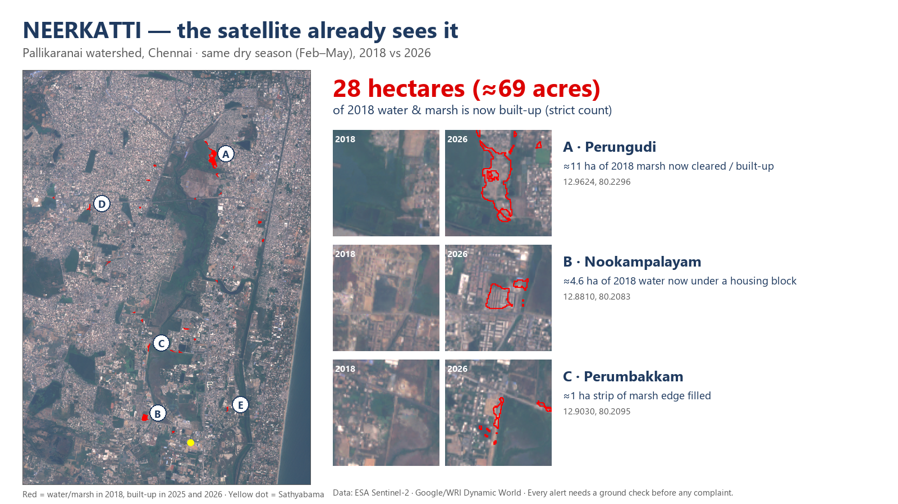

# NEERKATTI

An AI water-keeper for Chennai's wetlands. It catches illegal filling of lakes and marshes from free satellite data, confirms it with photos from citizens, and turns it into a ready-to-send complaint.

DEXATHON 2026 · Track: Sustainability Development · Team: Sternritters

**Live map (Round 2 prototype):** <https://athulyapandian24.github.io/neerkatti/app/>. Compare 2018 and 2026, switch to the AI labels, and tap any of the top 10 patches to zoom to it.

**Project page:** <https://athulyapandian24.github.io/neerkatti/>. A 2018 ↔ 2026 slider and the checked sites.



## What v1 finds (first real run, 15 Oct 2026)

- **Study area:** Pallikaranai watershed, box `[80.17, 12.86, 80.26, 12.99]` (lon/lat).
- **Dates:** the same dry season (Feb–May) in 2018 and 2026.
- **Water + marsh:** 1,628 ha in 2018 and 1,702 ha in 2026. The total is roughly the same; the 2026 dry season was wetter.
- **Loss (strict count):** 28.1 ha (≈69 acres) of 2018 water/marsh is built-up in **both** 2025 and 2026.
- **Biggest sites, all checked by eye on the before/after photos** (`outputs/closeups.png`):
  - **A · Perungudi:** about 11 ha of marsh is now cleared and built-up.
  - **B · Nookampalayam:** about 4.6 ha of 2018 water is now under a housing block.
  - **C · Perumbakkam:** a strip of marsh edge about 1 ha in size has been filled.
  - **D · Sunnambu Kulathur, E · Panaiyur:** smaller changes.
- **Top 10 checked by eye (20 Oct 2026):** on before/after close-ups and current high-resolution satellite imagery, **9 of the top 10 patches show real building, paving or filling; 1 is unclear.** Details in [`outputs/topten_check.md`](outputs/topten_check.md), close-ups in `outputs/topten/`.
- **How far to trust the AI labels:** Dynamic World's own validation gives 86.7% user's accuracy for built-up land but only 36.8% producer's accuracy for marsh (Brown et al. 2022, Tables 7–8). It misses a lot of marsh, so 28.1 ha is a cautious count.
- **Status of every alert:** "possible change, needs a ground check". Nothing here names or accuses any owner.

## Round 2 web app (`docs/app/`)

A Leaflet map of the Pallikaranai watershed. It is a static site: no server, no API key, no Earth Engine login.

- **2018 / Compare / 2026.** In Compare mode, drag the divider across the map: 2018 on the left, 2026 on the right. It also works with the arrow keys.
- **Satellite or AI labels.** The Sentinel-2 photo (Feb–May median), or the Dynamic World label of every 10 m square (water, marsh, trees, buildings…).
- **All 36 flagged patches** as red polygons (28.1 ha in total). Click one for its area, its status and a Google Maps satellite link.
- **Top 10 list.** Click a row to fly to that patch. The link updates to `#patch-N`, so a view can be shared. Each row says what the satellite images show (sites A, B and C are marked).
- **Every patch is labelled "possible change, needs a ground check".** No owners are named; place names are suburb-level only.
- **Works on a phone** (checked at 375 px) and in light and dark mode.
- **Open data.** [`docs/app/data/patches.geojson`](docs/app/data/patches.geojson) has every patch with its area, rank and status.

Earth Engine map-tile links expire after a few hours, so `analysis/app_assets.py` exports everything the app shows as static files:

| File | What it is |
|---|---|
| `photo_2018.jpg`, `photo_2026.jpg` | Sentinel-2 true colour, Feb–May median (13 and 19 clear images), ≈10 m per pixel |
| `labels_2018.png`, `labels_2026.png` | Dynamic World label for each square (most common in Feb–May). Dynamic World's colours, except buildings (grey) and bare soil (sand), so red only ever means a flagged patch |
| `patches.geojson` | The v1 change patches, from `reduceToVectors`, ranked by area. Polygon areas add up to 28.2 ha; the 28.1 ha headline is the pixel count |
| `neerkatti_data.js` | The same patches plus the numbers and map labels, loaded by the page |

The alerts, the citizen photo check and the complaint PDF are built during the 24-hour final, as the rules require.

## How it works

1. **Satellite labels.** Google/WRI *Dynamic World* labels every 10 m square of Sentinel-2 imagery: water, trees, grass, marsh, crops, shrubs, buildings, bare soil.
2. **Season summary.** For each year, take the most common label for each square during Feb–May.
3. **Change rule (v1).** A square counts as lost if:
   - it was water or marsh in 2018,
   - it is **not** on the outer ~20 m rim of a water body (edge squares mix water with nearby buildings and caused false alarms in v0), and
   - it is labelled buildings in **both** 2025 and 2026.
4. **Noise filter.** Drop patches smaller than about 0.1 ha.

## Run it

**Option A, in the browser.** Paste `earthengine/neerkatti_v1.js` into <https://code.earthengine.google.com> and press **Run**. You get a 2018 | 2026 wipe slider, a legend, and the numbers.

**Option B, from Python.** This saves the images and the list of spots.

```bash
python -m venv .venv
.venv/Scripts/python -m pip install -r requirements.txt
.venv/Scripts/python -c "import ee; ee.Authenticate()"
.venv/Scripts/python analysis/change_map.py      # stats.json, top_spots.csv, maps
.venv/Scripts/python analysis/spot_closeups.py   # closeups.png (before/after per spot)
.venv/Scripts/python analysis/make_slide.py      # slide3_neerkatti.png
.venv/Scripts/python analysis/demo_assets.py     # docs/img/ (images for the project page)
.venv/Scripts/python analysis/app_assets.py      # docs/app/data/ (images + patches for the live map)
.venv/Scripts/python analysis/topten_closeups.py # outputs/topten/ (2018 | 2026 close-up of each top-10 patch)
```

**Option C, the web app.** Serve the `docs/` folder and open the map:

```bash
.venv/Scripts/python -m http.server 8765 --directory docs
```

Then go to <http://localhost:8765/app/>. Opening `docs/app/index.html` straight from the file system also works.

The scripts use the Earth Engine Cloud project `dexathon-athulya` (non-commercial, Community tier).

## Roadmap

- [x] v0/v1: change map + top spots + slide image
- [x] Live demo page: 2018 ↔ 2026 slider + checked sites + top-10 list (`docs/`, GitHub Pages)
- [x] Round 2 web app: Leaflet map + 2018 / 2026 compare + AI labels + all patches + top-10 list (`docs/app/`)
- [ ] Final (24 h): new-change alerts, citizen photo check, complaint PDF, monsoon radar mode

## Sources

- Dynamic World V1: `GOOGLE/DYNAMICWORLD/V1` (Google & World Resources Institute)
- Sentinel-2: `COPERNICUS/S2_HARMONIZED` (ESA Copernicus)
- Place names: OpenStreetMap Nominatim
- Map background: © OpenStreetMap contributors (tile.openstreetmap.org); map library: Leaflet 1.9.4
