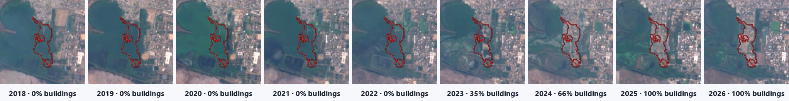
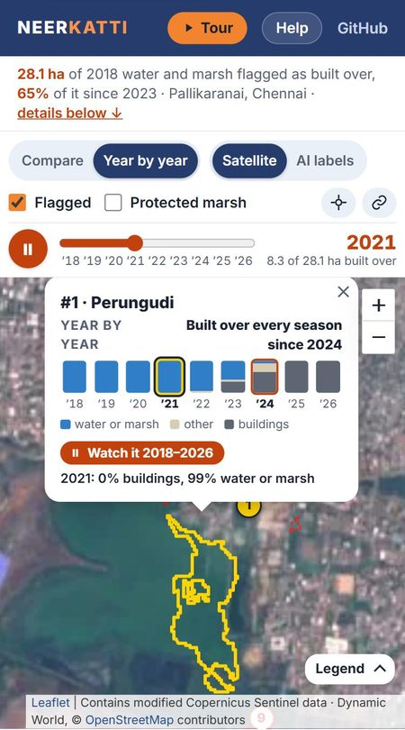
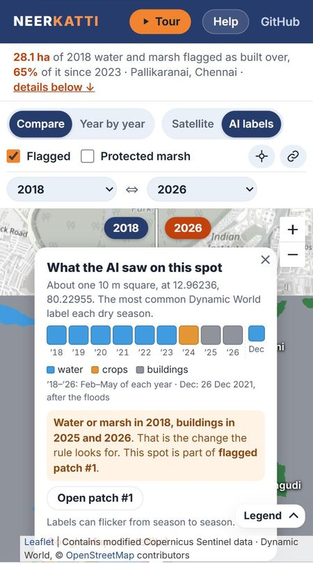
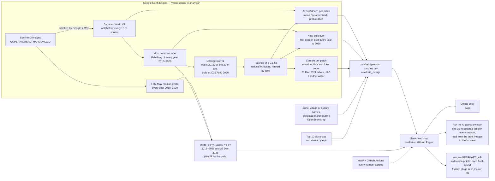

# NEERKATTI

[](https://github.com/ATHULYAPANDIAN24/neerkatti/actions/workflows/tests.yml)

> **For judges, in five lines**
> 1. **What it is:** a live map of where Chennai's Pallikaranai wetlands turned into buildings, 2018–2026: **28.1 ha in 36 patches**, each a possible change that needs a ground check.
> 2. **Open it:** <https://athulyapandian24.github.io/neerkatti/app/>, on a phone or a laptop (it works offline too); the [60-second path](#try-it-in-60-seconds) shows what to try.
> 3. **Where the AI is:** Google's Dynamic World deep-learning model labels every 10 m square of every Sentinel-2 image; our change rule, AI confidence and year-by-year timeline sit on top ([model and data card](docs/MODEL_CARD.md)). Tap any spot on the map to see what the AI saw there.
> 4. **New in Round 2:** the live map itself: every dry season 2018–2026, 36 patches with close-ups, the year each was built over, the protected marsh and the 2021 floods, the spot question, open CSV, offline use, tests on every push.
> 5. **In the 24-hour final:** alerts for new changes, a citizen photo check by a vision model, a complaint PDF in Tamil and English, and Sentinel-1 radar ([plan](docs/FINAL_ROUND_PLAN.md)).

**An AI water-keeper for Chennai's wetlands.** NEERKATTI follows the Pallikaranai watershed through every dry season from 2018 to 2026 in free satellite images. Google's Dynamic World AI model labels every 10 m square of land, and our rule flags 2018 water or marsh that is built-up in both 2025 and 2026. Each flagged patch then gets the year it was built over, its distance from the protected marsh, and what it looked like after the 2021 floods.

DEXATHON 2026 · Sustainability Development track · Software · Team Sternritters (DEX26302)

| | |
|---|---|
| **Live map (Round 2 prototype)** | <https://athulyapandian24.github.io/neerkatti/app/> |
| **Project page** | <https://athulyapandian24.github.io/neerkatti/> |
| **Open data** | [`patches.csv`](docs/app/data/patches.csv) (spreadsheet) and [`patches.geojson`](docs/app/data/patches.geojson) (outlines): every flagged patch with its zone or village, AI confidence, year built over, marsh distance and every season's shares |
| **Model and data card** | [`docs/MODEL_CARD.md`](docs/MODEL_CARD.md): the AI, what our code adds, accuracy, known failure modes, intended and out-of-scope uses |
| **24-hour final plan** | [`docs/FINAL_ROUND_PLAN.md`](docs/FINAL_ROUND_PLAN.md): what we build on 4–5 Nov, who does what, risks and fallbacks |

[](https://athulyapandian24.github.io/neerkatti/#timelapse)

*Patch #1 in Perungudi, every dry season 2018–2026, with the share the AI labels buildings ([`analysis/patch_timelapse.py`](analysis/patch_timelapse.py)). Inside the protected marsh outline; a possible change that needs a ground check.*

## Try it in 60 seconds

| | What to do | Link |
|---|---|---|
| 1 | **Watch the tour.** Six steps that play by themselves (Pause, Back and Next work): compare, year by year, the AI's labels, the biggest patch, the protected marsh, the 2021 floods. | [`/app/?tour=1`](https://athulyapandian24.github.io/neerkatti/app/?tour=1) |
| 2 | **Watch a patch.** Open patch #1 and press *Watch it 2018–2026*: the card folds to its season bars and the map plays the seasons up close. | [`/app/#patch-1`](https://athulyapandian24.github.io/neerkatti/app/#patch-1) |
| 3 | **Ask the AI about any spot.** Tap anywhere on the map, flagged or not: the label the AI gave that 10 m square in every season, and what the rule makes of it. | [`/app/#layer=labels`](https://athulyapandian24.github.io/neerkatti/app/?intro=0#layer=labels) |
| 4 | **Check the marsh.** 28 of 36 patches lie in the protected marsh or within 1 km of it. | [`/app/#marsh=1`](https://athulyapandian24.github.io/neerkatti/app/?intro=0#marsh=1) |
| 5 | **Take the data.** Every patch with every season's shares, as a spreadsheet. | [`patches.csv`](docs/app/data/patches.csv) |

It runs in any browser, on a phone too, and keeps working offline once opened.

<p>
  
  
</p>

*On a phone: watching patch #1 season by season (left), and asking the AI about a spot inside it (right).*

## Results

| What | Value | Where it comes from |
|---|---|---|
| 2018 water and marsh flagged as built over | **28.1 ha** (≈69 acres), pixel count | [`outputs/stats.json`](outputs/stats.json) |
| Flagged patches of at least ~0.1 ha | **36 patches** (their polygons add up to 28.23 ha) | [`docs/app/data/patches.geojson`](docs/app/data/patches.geojson) |
| Top 10 checked by eye | **9 of the top 10** show building, paving or filling; 1 is unclear | [`outputs/topten_check.md`](outputs/topten_check.md) |
| AI confidence, all 36 patches | 8 high, 18 medium, 10 low (Dynamic World's own probabilities) | [`analysis/patch_details.py`](analysis/patch_details.py) |
| When the 28.1 ha was built over | 2.0, 2.8, 3.4, 1.5, 5.3, 6.2 and 7.0 ha in 2019 … 2025: **18.4 ha (65%) in the last three seasons** | [`analysis/year_by_year.py`](analysis/year_by_year.py) |
| Near the protected marsh | **28 of 36 patches** overlap the marsh outline or lie within 1 km of it; 12 overlap it, with 12.7 ha of flagged land inside | [`analysis/context_layers.py`](analysis/context_layers.py) |
| After the 2021 floods (26 Dec 2021) | at least 2,115 ha of the study area water or marsh, against 1,628 ha in the 2018 dry season; **18 flagged patches** (17.6 ha) still at least half water or marsh | [`analysis/context_layers.py`](analysis/context_layers.py) |
| Second opinion: Landsat water history | open water seen at some time in 1984–2021 on at least a quarter of 22 patches (JRC Global Surface Water) | [`analysis/context_layers.py`](analysis/context_layers.py) |
| Water and marsh in the study area | 1,628 ha in 2018, 1,702 ha in 2026 | [`outputs/stats.json`](outputs/stats.json) |
| Study area | Pallikaranai watershed, 80.17–80.26°E, 12.86–12.99°N | [`analysis/app_assets.py`](analysis/app_assets.py) |

The top-10 check is a visual check of 2018 | 2026 Sentinel-2 close-ups and current high-resolution satellite imagery, not a ground survey. Every patch stays a **possible change that needs a ground check**.

## Working now vs final round

| Working now (Round 2) | Built in the 24-hour final (4–5 Nov) |
|---|---|
| Every dry season 2018–2026: a year-by-year player in which each patch fills red from the season it was built over, or any two seasons side by side with a draggable divider | Alerts for new changes, first inside the protected marsh's 1 km zone |
| AI land labels for every 10 m square, every season; tap any spot to see its label in every season and what the rule makes of it | Citizen photo check by a vision model |
| All 36 flagged patches with 2018 \| 2026 close-ups, what the AI saw there each season, the year it was built over, zone or village names and an AI confidence level; *Watch it 2018–2026* plays any patch's seasons up close; the top 10 checked by eye | Complaint PDF in Tamil and English |
| The protected marsh (OpenStreetMap outline) and its 1 km zone; the marsh after the 2021 floods; Landsat's water history as a second opinion | Sentinel-1 radar through monsoon clouds |
| Charts: hectares built over per season, flagged hectares by zone or village and by distance from the marsh; a what-if for the water the lost marsh could hold | |
| A list you can sort by size, newest, confidence or area; "near me" (the location stays on the device); a 6-step guided tour that plays itself; shareable links such as `#patch-4&year=2021&layer=labels&marsh=1` | |
| Works offline once opened, every season included, and installs on a phone's home screen | |
| Open CSV and GeoJSON; 42 consistency tests and 19 map-logic tests, run by GitHub Actions on every push | |
| Extension points for the final: `window.NEERKATTI_API` lets each final-round feature live in its own file | |

The DEXATHON rules say major features are built during the 24-hour final, so the right-hand column is a plan, not code. The hour-by-hour plan for four people, with risks, fallbacks and the data formats, is in [`docs/FINAL_ROUND_PLAN.md`](docs/FINAL_ROUND_PLAN.md).

## Architecture



Earth Engine map-tile links expire after a few hours, so [`analysis/app_assets.py`](analysis/app_assets.py) exports everything the map shows as static files. The site needs no server, no API key and no Earth Engine login. Leaflet is served from the site itself ([`docs/app/vendor/leaflet`](docs/app/vendor/leaflet)), so the map does not wait on a CDN, and the web font loads without blocking the page.

## How it works

1. **Satellite labels.** Dynamic World, from Google and the World Resources Institute, runs a deep-learning model on every Sentinel-2 image and labels each 10 m square: water, trees, grass, flooded vegetation (marsh), crops, shrub and scrub, built, bare or snow.
2. **Season summary.** For each year we keep the most common label of each square in the Feb–May dry season, when there are fewest clouds.
3. **Change rule (v1).** A square is flagged if:
   - it was water or marsh in 2018,
   - it is not on the outer ~20 m rim of a 2018 water body (`focalMin`, 20 m). Edge squares mix water with nearby roofs and caused thin false lines along lake shores in v0, and
   - it is labelled built in **both** 2025 and 2026, so a single mislabelled season is not enough.
4. **Noise filter.** Groups of fewer than 10 connected squares (~0.1 ha) are dropped.
5. **Patches.** `reduceToVectors` turns the flagged squares into polygons, ranked by area. Place names come from OpenStreetMap Nominatim and are never finer than a suburb. Here Nominatim returns Greater Chennai Corporation zones and wards rather than suburbs, so patches outside the top 10 are named by zone ("Perungudi zone"), or by village outside the city.
6. **AI confidence.** For every patch, [`analysis/patch_details.py`](analysis/patch_details.py) averages Dynamic World's own probabilities over the patch and the Feb–May images: "water" plus "flooded vegetation" in 2018, and "built" in 2025 and in 2026. The weakest of the three sets the level, with thresholds fixed before the numbers were computed: **high** from 0.50, **medium** from 0.35, **low** below. It is the model's certainty, not a measure of truth: among the top 10, the unclear patch (#9) is medium, like six of the nine confirmed ones. Its use is to say which unchecked patches to look at first.
7. **Check by eye.** For the top 10 we compared 2018 | 2026 close-ups ([`analysis/topten_closeups.py`](analysis/topten_closeups.py)) with current high-resolution imagery and wrote down what each one shows. `app_assets.py` stops if a top-10 patch has moved more than 60 m from where it was checked, so a re-run cannot attach a finding to the wrong patch.
8. **Year by year.** [`analysis/year_by_year.py`](analysis/year_by_year.py) makes the same photo and label summary for every dry season in between. For each flagged square it finds the first season from which the square is labelled built in **every** season through 2026; a square that flips back to marsh for one season counts only from after the flip, so the year is a cautious one. Summed over the squares this splits the 28.1 ha by year; per patch, `built_since` is the season by which half of the patch had been built over for good. The popup shows each season's share of water or marsh and of buildings as it is, flicker included.
9. **Context.** [`analysis/context_layers.py`](analysis/context_layers.py) adds, for every patch:
   - how much of it lies inside the protected marsh as mapped in OpenStreetMap (relation 15046539, tagged Reserve Forest and Ramsar site), or how far it is from it. The National Green Tribunal's order of 24 Sep 2025 bars approvals within a 1 km zone of influence around the Ramsar site; the map draws our own 1 km buffer of the OSM outline, which is volunteer-mapped and not the official survey;
   - the share labelled water or marsh on 26 Dec 2021, the clearest Sentinel-2 image after Chennai's November 2021 floods. It was picked by the cloud over the study area itself (7%), not the whole tile: the 6 Dec image is rated 5% cloudy for the tile but is 95% cloud over the study area. Squares under cloud stay unlabelled;
   - the share where Landsat saw open water at some time in 1984–2021 (JRC Global Surface Water `max_extent`), an independent check on "this was water". It cannot see water under marsh plants, so a low value does not count against a patch;
   - ESA WorldCover 2021's built-up and wetland shares, kept in the open data. It is a separate AI map and often labels new construction as bare ground or grass, so the app does not use it as a check.

   We also tried Sentinel-1 radar from 6 Dec 2015, four days after the 2015 floods, but the flooded area came out bright, not dark (most likely water under marsh plants, and wind or rain on open water, sending the radar back), so a simple threshold found less water than in the dry season. That layer was dropped.

10. **Ask the AI about any spot.** The map reads the AI label images it already shows (lossless WebP, one colour per label) at the tapped spot, for every season, in the browser: no server. It then applies the label test of the rule to that one square: water or marsh in 2018 and buildings in 2025 and 2026. The full rule also needs the square off the 20 m lake rim and inside a group of at least 10, so the popup says when a spot is part of a flagged patch.

## Why this area and these years

| Dry season (Feb–May) | 2016 | 2017 | **2018** | 2019 | 2020 | 2021 | 2022 | 2023 | 2024 | **2025** | **2026** |
|---|---|---|---|---|---|---|---|---|---|---|---|
| Dynamic World images of the study area | 4 | 4 | **18** | 21 | 20 | 19 | 14 | 14 | 18 | **20** | **22** |

- **2018** is the first dry season with enough images. Sentinel-2B joined Sentinel-2A in 2017; a season summary made from 4 images can flip on one cloudy or mislabelled day. Dynamic World has no labels before 2015 at all.
- **2025 and 2026** are the two latest complete dry seasons; the rule needs a square to be built-up in both.
- **One watershed**, so that every result could be checked: the top 10 by eye, every patch with the AI's confidence. Pallikaranai is a Ramsar wetland (site 2481), one 10 m study area fits the free Earth Engine tier, and the site needs no server. Nothing in the rule is tied to this box (`BOX` in the scripts), so a Chennai-wide run is the same code over a bigger area.

## Reproduce it

You need Python 3.12 or newer and a Google Earth Engine account with a Cloud project registered for Earth Engine (non-commercial use is free).

```bash
git clone https://github.com/ATHULYAPANDIAN24/neerkatti
cd neerkatti
python -m venv .venv
.venv/Scripts/python -m pip install -r requirements.txt   # macOS/Linux: .venv/bin/python
.venv/Scripts/python -c "import ee; ee.Authenticate()"
export EE_PROJECT=your-cloud-project                       # PowerShell: $env:EE_PROJECT = "your-cloud-project"
```

Then run the steps in order. Each step reads only what the earlier ones wrote.

| Step | Command | Writes |
|---|---|---|
| 1 | `.venv/Scripts/python analysis/change_map.py` | `outputs/stats.json`, `outputs/top_spots.csv`, overview maps |
| 2 | `.venv/Scripts/python analysis/app_assets.py` | `docs/app/data/`: photos, AI labels, `patches.geojson`, `neerkatti_data.js` |
| 3 | `.venv/Scripts/python analysis/patch_details.py` | adds zone or village names, AI confidence and the images-per-season counts; close-ups of patches 11–36 in `outputs/closeups/` |
| 4 | `.venv/Scripts/python analysis/topten_closeups.py` | `outputs/topten/`: a 2018 \| 2026 close-up of each top-10 patch |
| 5 | `.venv/Scripts/python analysis/app_closeups.py` | `docs/app/data/closeups/`: web-sized copies (no Earth Engine) |
| 6 | `.venv/Scripts/python analysis/web_images.py` | `docs/app/data/*.webp`: the map images as WebP, at the map's Web Mercator shape, plus light copies of the photos to show first (no Earth Engine) |
| 7 | `.venv/Scripts/python analysis/demo_assets.py` | `docs/img/`: images for the project page |
| 8 | `.venv/Scripts/python -m unittest discover -s tests -v` and `node --test tests/*.test.js` | nothing; checks that every number agrees and the map logic works |

Steps added for the year-by-year map, run after step 3 (rebuild.py puts them in the right place):

| Step | Command | Writes |
|---|---|---|
| 3a | `.venv/Scripts/python analysis/year_by_year.py` | photos and AI labels for 2019–2025; each season's shares and `built_since` per patch; hectares per season |
| 3b | `.venv/Scripts/python analysis/context_layers.py` | `marsh_boundary.geojson`, the 26 Dec 2021 photo and labels, marsh distance, flood, Landsat and WorldCover shares per patch |
| 6a | `.venv/Scripts/python analysis/open_data.py` | `docs/app/data/patches.csv` (no Earth Engine) |
| 7a | `.venv/Scripts/python analysis/patch_timelapse.py` | `docs/img/timelapse/`: patch #1 in every dry season, and the link previews `og.jpg` and `og-map.jpg` (numbers read from the data) |

Or run them all with **`.venv/Scripts/python analysis/rebuild.py`** (`--list` shows the 13 steps, `--from 5` starts at step 5). The scripts in steps 2–4 import their neighbours, so run them from inside `analysis/` (rebuild.py does). `requirements.txt` pins the versions the published data was made with.

`analysis/spot_closeups.py` and `analysis/make_slide.py` made the Round 1 deck images. Without Python, paste [`earthengine/neerkatti_v1.js`](earthengine/neerkatti_v1.js) into the [Earth Engine Code Editor](https://code.earthengine.google.com) and press **Run** to get the same rule with a 2018 | 2026 wipe slider.

To view the site on your own machine:

```bash
.venv/Scripts/python -m http.server 8765 --directory docs
```

Then open <http://localhost:8765/app/>. Opening `docs/app/index.html` straight from the file system also works.

## Tests

[GitHub Actions](.github/workflows/tests.yml) runs both test files on every push and pull request; neither needs Earth Engine or the network.

[`tests/test_consistency.py`](tests/test_consistency.py) (Python standard library only) checks that:

- the headline (28.1 ha) and the patch count (36) in the map's data match `outputs/stats.json`;
- the page data equals `patches.geojson`, and the patches are ranked by area, lie inside the study area, are all marked "possible change, needs a ground check" and carry only area-level names (suburb, village or Corporation zone);
- the top 10 match `top_spots.csv` and `topten_check.md` (9 real, 1 unclear);
- the numbers written on the live map, the project page and this README match the data;
- the Round 1 deck says the same (only when the deck file is present locally);
- every patch has a close-up and an AI confidence level that follows from its probabilities, and the images-per-season note matches the data;
- every season has its photo and labels; each patch's season shares follow the rule (water or marsh in 2018, buildings in 2025 and 2026); the hectares per season add up to 28.1; the marsh, flood and Landsat values are in range; the CSV matches the GeoJSON; and the year-by-year, marsh and flood numbers written on the page match the data;
- the project page's season-by-season view of patch #1 matches the data, frame by frame;
- the offline copy keeps every season's light photo and AI labels, the light photos are as wide as the map expects, and the label images stay lossless at the map's shape (the spot question reads exact colours);
- the bundled Leaflet is byte-identical to the published 1.9.4 build, the app loads no script from a CDN, every file the offline copy lists exists, and every local link exists.

[`tests/core.test.js`](tests/core.test.js) (Node's built-in test runner) checks the map's own logic in [`docs/app/core.js`](docs/app/core.js): distances, sorting, zone and village totals, keeping pins and labels apart, the shareable address (seasons, compare sides, marsh outline), the marsh status, the year a patch is drawn as built, the water-storage what-if in lakh and crore litres, when the full satellite photo is worth fetching, and the spot question: which pixel of a label image is under a point, which label a colour is, what the rule makes of a spot's seasons, and whether a point lies in a patch.

## Quality checks

[PageSpeed Insights](https://pagespeed.web.dev/analysis/https-athulyapandian24-github-io-neerkatti-app/1t9l0f4z08?form_factor=mobile) (Lighthouse 13.5.0) on the live map, two runs on 29 Oct 2026 at 12:34 and [12:36 IST](https://pagespeed.web.dev/analysis/https-athulyapandian24-github-io-neerkatti-app/pjfxdytipn?form_factor=mobile):

| Live map | Performance | Accessibility | Best practices | SEO |
|---|---|---|---|---|
| Phone (emulated Moto G Power, slow 4G) | 72, 73 | 100 | 96 | 100 |
| Desktop | 99, 96 | 100 | 100 | 100 |

On the phone the score is held back by Largest Contentful Paint (5.5 and 5.3 s): the 2026 satellite photo is drawn once Leaflet, the map's data and its code have loaded over the slow emulated connection. Since 29 Oct the full photo is fetched only where it shows more than the light one; before that it was the largest paint, at 8.1 s (Performance 68 in two runs that morning). The offline copy of every season is saved after the page has loaded, so it is not part of the page weight PageSpeed measures.

- **axe-core 4.10:** no violations on the live map (the intro, a patch card, a spot popup, the tour, the AI labels with the marsh outline, the year player) or on the project page, in light and dark, at desktop and phone width; checked again on 29 Oct after that day's fixes.
- **Offline:** with the server stopped, the map reloads from the offline copy, plays every season's photo and AI labels, shows the 2021 flood image and still answers the spot question.
- **The one best-practice note:** OpenStreetMap's base tiles are 256 px and look soft on high-density phone screens. Sharper tiles would mean four times as many requests to OSM's volunteer-run servers, so we left them.

## Repository layout

```
analysis/        Earth Engine and image scripts (Python)
earthengine/     the same rule as a Code Editor script
outputs/         stats.json, top_spots.csv, topten_check.md, close-ups
docs/            the GitHub Pages site
  index.html       project page
  404.html         for a mistyped address: links back to the live map
  FINAL_ROUND_PLAN.md  the 24-hour plan for the final
  MODEL_CARD.md    the model and data card
  img/timelapse/   patch #1 in every dry season (patch_timelapse.py)
  app/             live map: index.html, app.js (page), core.js (logic), app.css
    sw.js          offline copy; manifest.webmanifest and icons/ for installing
    data/          exported images, patches.geojson, close-ups
    vendor/        Leaflet 1.9.4 (BSD-2-Clause)
tests/           consistency checks (Python) and map-logic tests (Node)
.github/         the GitHub Actions workflow that runs them
```

## Data sources and licences

| What | Source | Licence or terms |
|---|---|---|
| Satellite images | Copernicus Sentinel-2, European Space Agency (`COPERNICUS/S2_HARMONIZED`) | Free and open; "Contains modified Copernicus Sentinel data" |
| AI land labels | Dynamic World V1, Google and World Resources Institute (`GOOGLE/DYNAMICWORLD/V1`) | CC BY 4.0 |
| Processing | Google Earth Engine, project registered for non-commercial use | Earth Engine terms of service |
| Base map, place names and the protected-marsh outline | © OpenStreetMap contributors (map tiles, Nominatim, relation 15046539) | ODbL; OSM tile and Nominatim usage policies |
| Landsat water history | JRC Global Surface Water 1.4, EC Joint Research Centre and Google (`JRC/GSW1_4/GlobalSurfaceWater`) | Free use with credit to the source |
| Second land-cover map | ESA WorldCover 2021 v200 (`ESA/WorldCover/v200`) | CC BY 4.0 |
| Map library | Leaflet 1.9.4 | BSD-2-Clause ([`LICENSE`](docs/app/vendor/leaflet/LICENSE)) |
| High-resolution imagery for the check by eye | Google Maps satellite view (imagery © 2026 Google) | Viewed only, not copied into this repository |
| Font | Inter, via Google Fonts | SIL Open Font License |
| Our code | This repository | MIT ([`LICENSE`](LICENSE)) |

Dynamic World accuracy figures: Brown, C.F. et al. (2022), *Dynamic World, near real-time global 10 m land use land cover mapping*, Scientific Data 9, 251, <https://www.nature.com/articles/s41597-022-01307-4>.

## Limitations

- **The AI labels are not perfect.** Dynamic World's own validation gives 86.7% user's accuracy for built-up land but only 36.8% producer's accuracy for marsh (Brown et al. 2022, Tables 7–8). It misses a lot of marsh, so 28.1 ha is a cautious count, not the full loss.
- **10 m squares are coarse.** Small dumping or a single building plot can be missed.
- **Dry season only, plus one flood image.** Monsoon clouds hide the ground for months. The year-by-year view uses dry seasons; the flood view is a single image (26 Dec 2021) with about 17% of the area under cloud. Radar is the final-round fix, though the 2015 test above shows it needs more than a threshold over marsh.
- **Season labels flicker.** Some patches read as buildings for one season and marsh the next. The popup bars show this as it is; the "built over since" year only counts unbroken runs.
- **The marsh outline is OpenStreetMap's**, volunteer-mapped, not the official Ramsar or Reserve Forest survey. Our patches were already built over by the 2025 dry season, before the Green Tribunal's order of September 2025.
- **"Built" includes filling.** Two of the nine confirmed patches (#6 and #7) are earth and debris filling, which Dynamic World labels as built.
- **One study area so far.** The rule has been run on the Pallikaranai watershed box only.
- **The check by eye is not a ground survey.**

The [model and data card](docs/MODEL_CARD.md) puts the data, the AI, the results, these failure modes and the uses NEERKATTI is not for on one page.

## Ethics

- Every patch is a **possible change that needs a ground check**. NEERKATTI flags a change in land cover; it does not decide whether anything is illegal.
- We never name owners, builders, companies or buildings. Place names are area-level only: suburb, village or Corporation zone.
- All data is public and free. The site has no analytics and sets no cookies. In your own browser it remembers that you closed the intro and keeps an offline copy of the map's files.
- "Near me" uses your location only inside your browser to sort the list; it is never sent anywhere.

## Roadmap

- [x] v0/v1: change map, top spots and the Round 1 slide images
- [x] Project page: 2018 ↔ 2026 slider, checked sites, top-10 list (`docs/`)
- [x] Round 2 live map: compare, AI labels, 36 patches, top-10 close-ups, guided tour, shareable views, tests (`docs/app/`)
- [x] Round 2 upgrade: close-ups, zone or village names and AI confidence for all 36; sort, area chart, near me; offline and installable; CI
- [x] Year by year: every dry season 2018–2026, the year each patch was built over, the protected marsh and its 1 km zone, the 2021 floods, Landsat's water history, open CSV
- [x] Ask the AI about any spot, watch any patch season by season, a tour that plays itself, every season offline, extension points for the final
- [ ] Final round (24 h, [plan](docs/FINAL_ROUND_PLAN.md)): new-change alerts (first inside the 1 km zone), citizen photo check, complaint PDF in Tamil and English, Sentinel-1 radar

Named after the *neerkatti*, Tamil Nadu's traditional lake-keepers. Team Sternritters, DEXATHON 2026, Sathyabama Institute of Science and Technology, Chennai.

## Licence

The code is released under the [MIT licence](LICENSE). The data products keep the terms of their sources, listed above.
