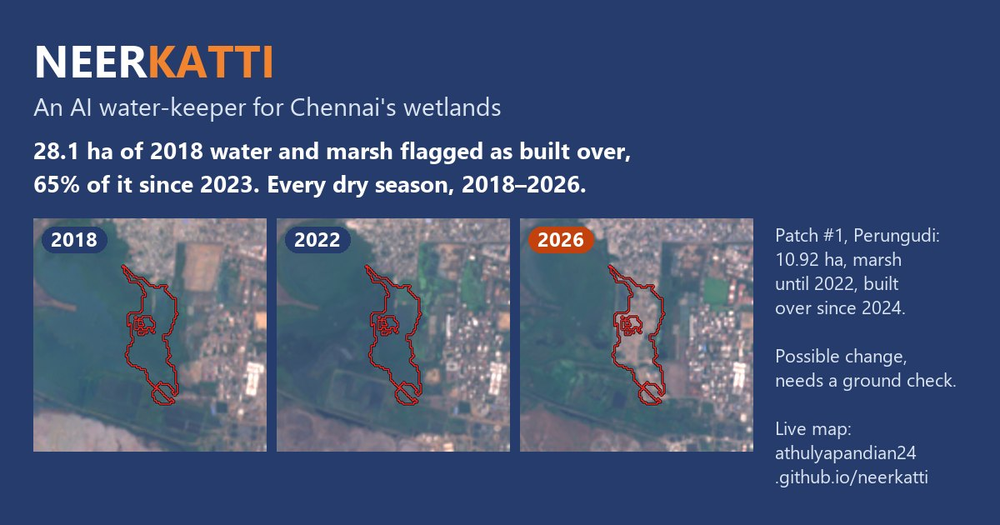
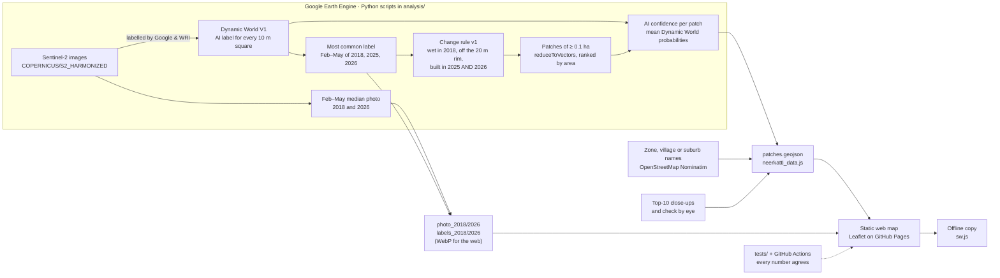

# NEERKATTI

[](https://github.com/ATHULYAPANDIAN24/neerkatti/actions/workflows/tests.yml)

**An AI water-keeper for Chennai's wetlands.** NEERKATTI compares free satellite images of the Pallikaranai watershed from the 2018 and 2026 dry seasons. Google's Dynamic World AI model labels every 10 m square of land, and our rule flags 2018 water or marsh that is built-up in both 2025 and 2026.

DEXATHON 2026 · Sustainability Development track · Software · Team Sternritters (DEX26302)

| | |
|---|---|
| **Live map (Round 2 prototype)** | <https://athulyapandian24.github.io/neerkatti/app/> |
| **Project page** | <https://athulyapandian24.github.io/neerkatti/> |
| **Open data** | [`docs/app/data/patches.geojson`](docs/app/data/patches.geojson), every flagged patch with its zone or village and AI confidence |

[](https://athulyapandian24.github.io/neerkatti/app/)

## Results

| What | Value | Where it comes from |
|---|---|---|
| 2018 water and marsh flagged as built over | **28.1 ha** (≈69 acres), pixel count | [`outputs/stats.json`](outputs/stats.json) |
| Flagged patches of at least ~0.1 ha | **36 patches** (their polygons add up to 28.23 ha) | [`docs/app/data/patches.geojson`](docs/app/data/patches.geojson) |
| Top 10 checked by eye | **9 of the top 10** show building, paving or filling; 1 is unclear | [`outputs/topten_check.md`](outputs/topten_check.md) |
| AI confidence, all 36 patches | 8 high, 18 medium, 10 low (Dynamic World's own probabilities) | [`analysis/patch_details.py`](analysis/patch_details.py) |
| Water and marsh in the study area | 1,628 ha in 2018, 1,702 ha in 2026 | [`outputs/stats.json`](outputs/stats.json) |
| Study area | Pallikaranai watershed, 80.17–80.26°E, 12.86–12.99°N | [`analysis/app_assets.py`](analysis/app_assets.py) |

The top-10 check is a visual check of 2018 | 2026 Sentinel-2 close-ups and current high-resolution satellite imagery, not a ground survey. Every patch stays a **possible change that needs a ground check**.

## Working now vs final round

| Working now (Round 2) | Built in the 24-hour final (4–5 Nov) |
|---|---|
| 2018 / 2026 satellite compare with a draggable divider | Alerts for new changes |
| AI land labels for every 10 m square | Citizen photo check by a vision model |
| All 36 flagged patches with 2018 \| 2026 close-ups, zone or village names and an AI confidence level; the top 10 checked by eye | Complaint PDF in Tamil and English |
| A list you can sort by size, confidence or area; flagged hectares by Corporation zone or village; "near me" (the location stays on the device) | Sentinel-1 radar for monsoon clouds |
| Guided tour; shareable links such as `#patch-4&year=2018&layer=labels` | |
| Works offline once opened, and installs on a phone's home screen | |
| Open GeoJSON; 25 consistency tests and 9 map-logic tests, run by GitHub Actions on every push | |

The DEXATHON rules say major features are built during the 24-hour final, so the right-hand column is a plan, not code.

## Architecture



Earth Engine map-tile links expire after a few hours, so [`analysis/app_assets.py`](analysis/app_assets.py) exports everything the map shows as static files. The site needs no server, no API key and no Earth Engine login. Leaflet is served from the site itself ([`docs/app/vendor/leaflet`](docs/app/vendor/leaflet)), so the map does not wait on a CDN, and the web font loads without blocking the page.

## How it works

1. **Satellite labels.** Dynamic World, from Google and the World Resources Institute, runs a deep-learning model on every Sentinel-2 image and labels each 10 m square: water, trees, grass, flooded vegetation (marsh), crops, shrub and scrub, built, bare or snow.
2. **Season summary.** For each year we keep the most common label of each square in the Feb–May dry season, when there are fewest clouds.
3. **Change rule (v1).** A square is flagged if:
   - it was water or marsh in 2018,
   - it is not on the outer ~20 m rim of a 2018 water body (`focalMin`, 20 m). Edge squares mix water with nearby roofs and caused thin false lines along lake shores in v0, and
   - it is labelled built in **both** 2025 and 2026, so a single mislabelled season is not enough.
4. **Noise filter.** Groups of fewer than 10 connected squares (~0.1 ha) are dropped.
5. **Patches.** `reduceToVectors` turns the flagged squares into polygons, ranked by area. Place names come from OpenStreetMap Nominatim and are never finer than a suburb. Here Nominatim returns Greater Chennai Corporation zones and wards rather than suburbs, so patches outside the top 10 are named by zone ("Perungudi zone"), or by village outside the city.
6. **AI confidence.** For every patch, [`analysis/patch_details.py`](analysis/patch_details.py) averages Dynamic World's own probabilities over the patch and the Feb–May images: "water" plus "flooded vegetation" in 2018, and "built" in 2025 and in 2026. The weakest of the three sets the level, with thresholds fixed before the numbers were computed: **high** from 0.50, **medium** from 0.35, **low** below. It is the model's certainty, not a measure of truth: among the top 10, the unclear patch (#9) is medium, like six of the nine confirmed ones. Its use is to say which unchecked patches to look at first.
7. **Check by eye.** For the top 10 we compared 2018 | 2026 close-ups ([`analysis/topten_closeups.py`](analysis/topten_closeups.py)) with current high-resolution imagery and wrote down what each one shows. `app_assets.py` stops if a top-10 patch has moved more than 60 m from where it was checked, so a re-run cannot attach a finding to the wrong patch.

## Why this area and these years

| Dry season (Feb–May) | 2016 | 2017 | **2018** | 2019 | 2020 | 2021 | 2022 | 2023 | 2024 | **2025** | **2026** |
|---|---|---|---|---|---|---|---|---|---|---|---|
| Dynamic World images of the study area | 4 | 4 | **18** | 21 | 20 | 19 | 14 | 14 | 18 | **20** | **22** |

- **2018** is the first dry season with enough images. Sentinel-2B joined Sentinel-2A in 2017; a season summary made from 4 images can flip on one cloudy or mislabelled day. Dynamic World has no labels before 2015 at all.
- **2025 and 2026** are the two latest complete dry seasons; the rule needs a square to be built-up in both.
- **One watershed**, so that every result could be checked: the top 10 by eye, every patch with the AI's confidence. Pallikaranai is a Ramsar wetland (site 2481), one 10 m study area fits the free Earth Engine tier, and the site needs no server. Nothing in the rule is tied to this box (`BOX` in the scripts), so a Chennai-wide run is the same code over a bigger area.

## Reproduce it

You need Python 3.12 or newer and a Google Earth Engine account with a Cloud project registered for Earth Engine (non-commercial use is free).

```bash
git clone https://github.com/ATHULYAPANDIAN24/neerkatti
cd neerkatti
python -m venv .venv
.venv/Scripts/python -m pip install -r requirements.txt   # macOS/Linux: .venv/bin/python
.venv/Scripts/python -c "import ee; ee.Authenticate()"
export EE_PROJECT=your-cloud-project                       # PowerShell: $env:EE_PROJECT = "your-cloud-project"
```

Then run the steps in order. Each step reads only what the earlier ones wrote.

| Step | Command | Writes |
|---|---|---|
| 1 | `.venv/Scripts/python analysis/change_map.py` | `outputs/stats.json`, `outputs/top_spots.csv`, overview maps |
| 2 | `.venv/Scripts/python analysis/app_assets.py` | `docs/app/data/`: photos, AI labels, `patches.geojson`, `neerkatti_data.js` |
| 3 | `.venv/Scripts/python analysis/patch_details.py` | adds zone or village names, AI confidence and the images-per-season counts; close-ups of patches 11–36 in `outputs/closeups/` |
| 4 | `.venv/Scripts/python analysis/topten_closeups.py` | `outputs/topten/`: a 2018 \| 2026 close-up of each top-10 patch |
| 5 | `.venv/Scripts/python analysis/app_closeups.py` | `docs/app/data/closeups/`: web-sized copies (no Earth Engine) |
| 6 | `.venv/Scripts/python analysis/web_images.py` | `docs/app/data/*.webp`: the map images as WebP, at the map's Web Mercator shape, plus light copies of the photos to show first (no Earth Engine) |
| 7 | `.venv/Scripts/python analysis/demo_assets.py` | `docs/img/`: images for the project page |
| 8 | `.venv/Scripts/python -m unittest discover -s tests -v` and `node --test tests/*.test.js` | nothing; checks that every number agrees and the map logic works |

Or run them all with **`.venv/Scripts/python analysis/rebuild.py`** (`--list` shows the steps, `--from 5` starts at step 5). The scripts in steps 2–4 import their neighbours, so run them from inside `analysis/` (rebuild.py does). `requirements.txt` pins the versions the published data was made with.

`analysis/spot_closeups.py` and `analysis/make_slide.py` made the Round 1 deck images. Without Python, paste [`earthengine/neerkatti_v1.js`](earthengine/neerkatti_v1.js) into the [Earth Engine Code Editor](https://code.earthengine.google.com) and press **Run** to get the same rule with a 2018 | 2026 wipe slider.

To view the site on your own machine:

```bash
.venv/Scripts/python -m http.server 8765 --directory docs
```

Then open <http://localhost:8765/app/>. Opening `docs/app/index.html` straight from the file system also works.

## Tests

[GitHub Actions](.github/workflows/tests.yml) runs both test files on every push and pull request; neither needs Earth Engine or the network.

[`tests/test_consistency.py`](tests/test_consistency.py) (Python standard library only) checks that:

- the headline (28.1 ha) and the patch count (36) in the map's data match `outputs/stats.json`;
- the page data equals `patches.geojson`, and the patches are ranked by area, lie inside the study area, are all marked "possible change, needs a ground check" and carry only area-level names (suburb, village or Corporation zone);
- the top 10 match `top_spots.csv` and `topten_check.md` (9 real, 1 unclear);
- the numbers written on the live map, the project page and this README match the data;
- the Round 1 deck says the same (only when the deck file is present locally);
- every patch has a close-up and an AI confidence level that follows from its probabilities, and the images-per-season note matches the data;
- the bundled Leaflet is byte-identical to the published 1.9.4 build, the app loads no script from a CDN, every file the offline copy lists exists, and every local link exists.

[`tests/core.test.js`](tests/core.test.js) (Node's built-in test runner) checks the map's own logic in [`docs/app/core.js`](docs/app/core.js): distances, sorting, zone and village totals, keeping pins and labels apart, and the shareable address.

## Quality checks

Lighthouse 12.8, 27 Oct 2026:

| Where | Performance | Accessibility | Best practices | SEO |
|---|---|---|---|---|
| Live site, desktop | 97 | 100 | 100 | 100 |
| Live site, mobile (simulated slow 4G) | 74 | 100 | 96 | 100 |
| Local copy, desktop | 96 | 100 | 100 | 100 |
| Local copy, mobile (simulated slow 4G) | 86 | 100 | 96 | 100 |

On the live mobile run the first satellite image took 8.3 s to appear: the two full images (about 680 KB) downloaded alongside the street-map tiles. Since then the map shows light 600 px copies first (about 200 KB for both years), swaps in the full images when they arrive, and loads the street map only after the satellite images. The live mobile score has not been measured again since that change.

- **axe-core 4.10:** no violations in light or dark mode at phone width, with every panel, a popup, the AI labels and the intro open.
- **The one best-practice note left:** OpenStreetMap's base tiles are 256 px and look soft on high-density phone screens. Sharper tiles would mean four times as many requests to OSM's volunteer-run servers, so we left them.

## Repository layout

```
analysis/        Earth Engine and image scripts (Python)
earthengine/     the same rule as a Code Editor script
outputs/         stats.json, top_spots.csv, topten_check.md, close-ups
docs/            the GitHub Pages site
  index.html       project page
  app/             live map: index.html, app.js (page), core.js (logic), app.css
    sw.js          offline copy; manifest.webmanifest and icons/ for installing
    data/          exported images, patches.geojson, close-ups
    vendor/        Leaflet 1.9.4 (BSD-2-Clause)
tests/           consistency checks (Python) and map-logic tests (Node)
.github/         the GitHub Actions workflow that runs them
```

## Data sources and licences

| What | Source | Licence or terms |
|---|---|---|
| Satellite images | Copernicus Sentinel-2, European Space Agency (`COPERNICUS/S2_HARMONIZED`) | Free and open; "Contains modified Copernicus Sentinel data" |
| AI land labels | Dynamic World V1, Google and World Resources Institute (`GOOGLE/DYNAMICWORLD/V1`) | CC BY 4.0 |
| Processing | Google Earth Engine, project registered for non-commercial use | Earth Engine terms of service |
| Base map and place names | © OpenStreetMap contributors (map tiles, Nominatim) | ODbL; OSM tile and Nominatim usage policies |
| Map library | Leaflet 1.9.4 | BSD-2-Clause ([`LICENSE`](docs/app/vendor/leaflet/LICENSE)) |
| High-resolution imagery for the check by eye | Google Maps satellite view (imagery © 2026 Google) | Viewed only, not copied into this repository |
| Font | Inter, via Google Fonts | SIL Open Font License |
| Our code | This repository | MIT ([`LICENSE`](LICENSE)) |

Dynamic World accuracy figures: Brown, C.F. et al. (2022), *Dynamic World, near real-time global 10 m land use land cover mapping*, Scientific Data 9, 251, <https://www.nature.com/articles/s41597-022-01307-4>.

## Limitations

- **The AI labels are not perfect.** Dynamic World's own validation gives 86.7% user's accuracy for built-up land but only 36.8% producer's accuracy for marsh (Brown et al. 2022, Tables 7–8). It misses a lot of marsh, so 28.1 ha is a cautious count, not the full loss.
- **10 m squares are coarse.** Small dumping or a single building plot can be missed.
- **Dry season only.** Monsoon clouds hide the ground for months; radar is the final-round fix.
- **"Built" includes filling.** Two of the nine confirmed patches (#6 and #7) are earth and debris filling, which Dynamic World labels as built.
- **One study area so far.** The rule has been run on the Pallikaranai watershed box only.
- **The check by eye is not a ground survey.**

## Ethics

- Every patch is a **possible change that needs a ground check**. NEERKATTI flags a change in land cover; it does not decide whether anything is illegal.
- We never name owners, builders, companies or buildings. Place names are area-level only: suburb, village or Corporation zone.
- All data is public and free. The site has no analytics and sets no cookies. In your own browser it remembers that you closed the intro and keeps an offline copy of the map's files.
- "Near me" uses your location only inside your browser to sort the list; it is never sent anywhere.

## Roadmap

- [x] v0/v1: change map, top spots and the Round 1 slide images
- [x] Project page: 2018 ↔ 2026 slider, checked sites, top-10 list (`docs/`)
- [x] Round 2 live map: compare, AI labels, 36 patches, top-10 close-ups, guided tour, shareable views, tests (`docs/app/`)
- [x] Round 2 upgrade: close-ups, zone or village names and AI confidence for all 36; sort, area chart, near me; offline and installable; CI
- [ ] Final round (24 h): new-change alerts, citizen photo check, complaint PDF in Tamil and English, Sentinel-1 radar

Named after the *neerkatti*, Tamil Nadu's traditional lake-keepers. Team Sternritters, DEXATHON 2026, Sathyabama Institute of Science and Technology, Chennai.

## Licence

The code is released under the [MIT licence](LICENSE). The data products keep the terms of their sources, listed above.
